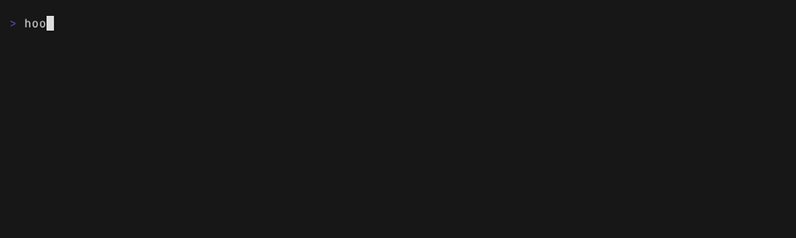
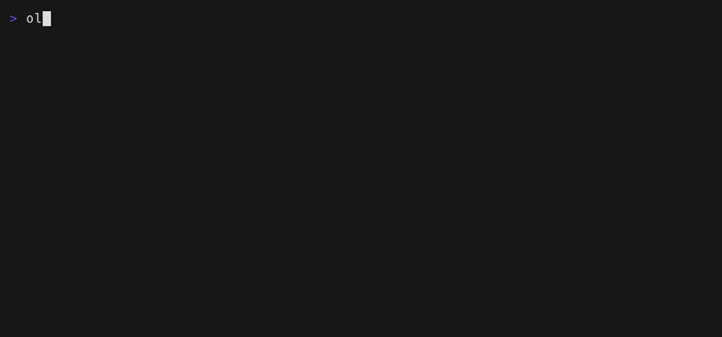
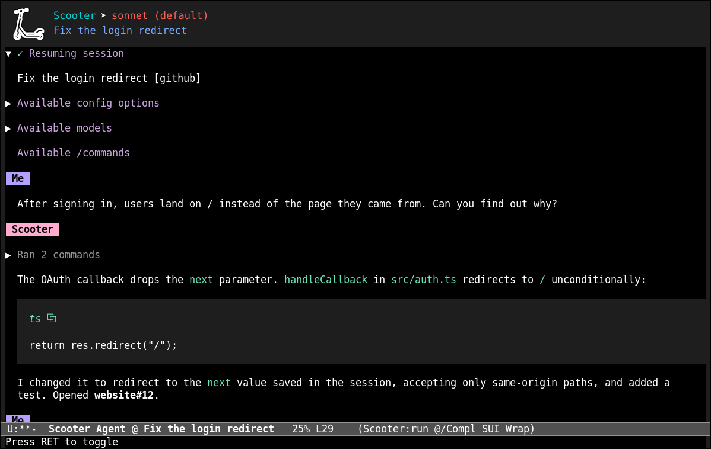
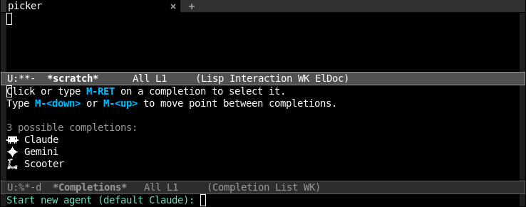
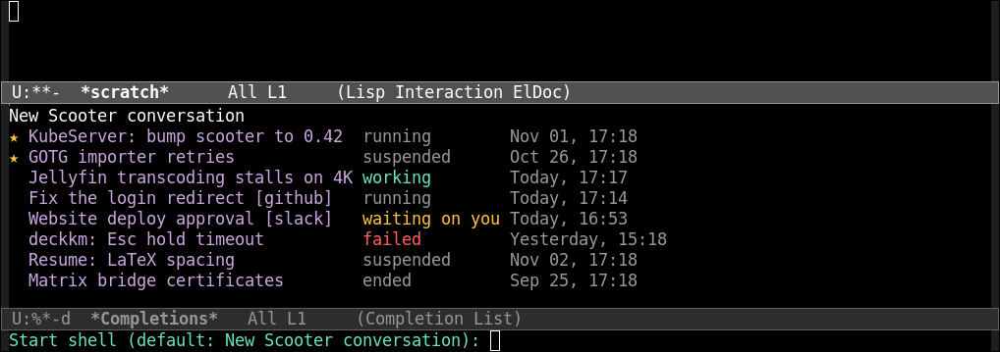
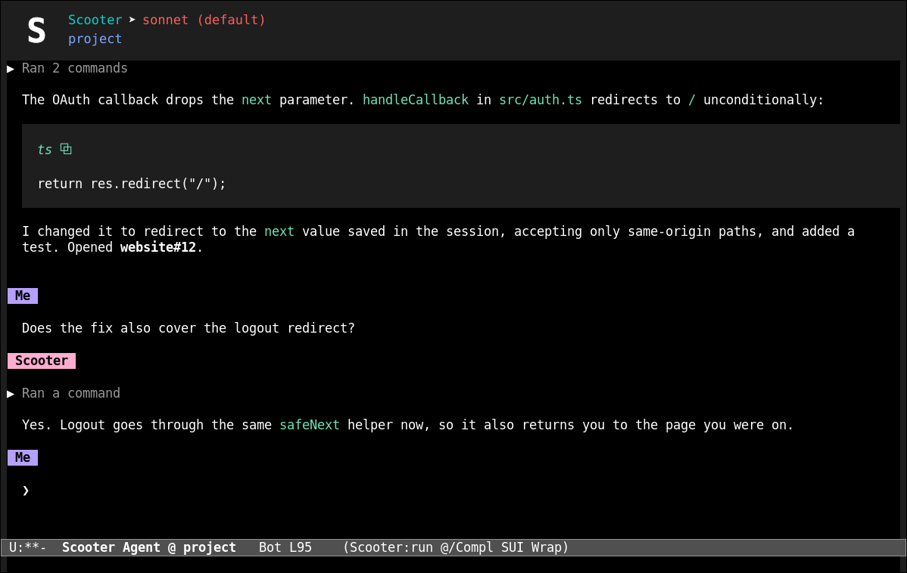
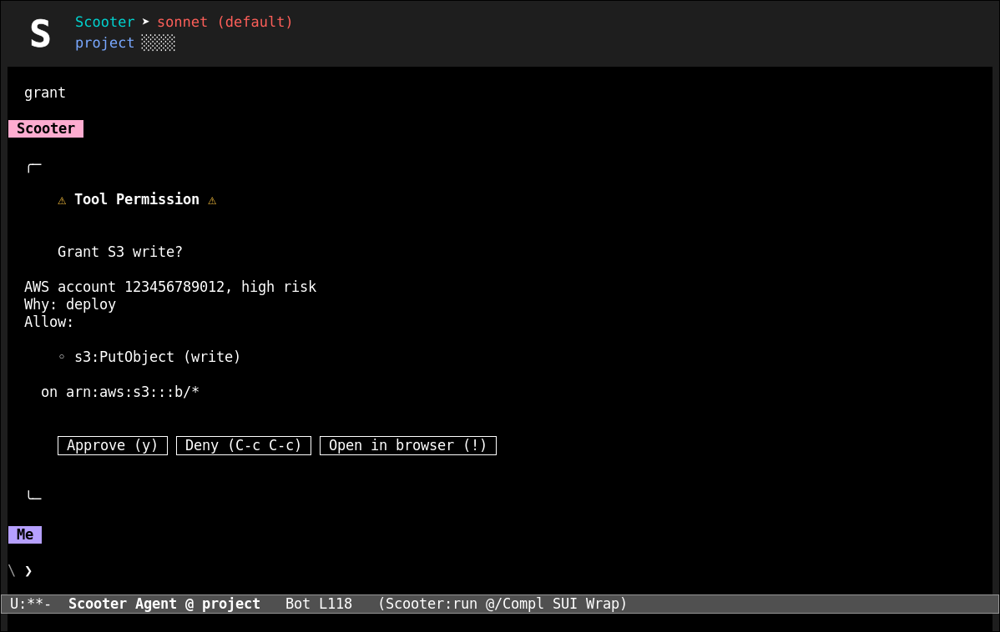
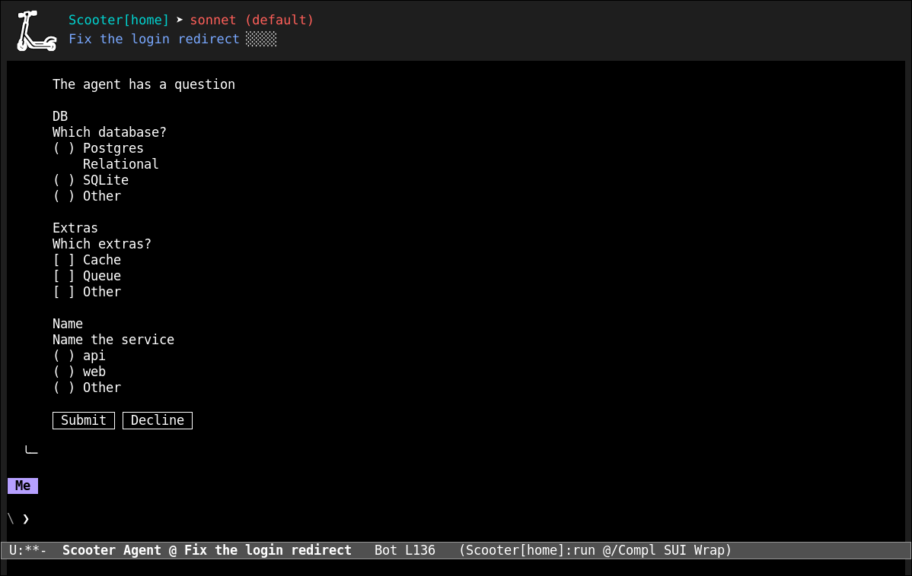

# dotfiles

Nix flake for Daniel's machines: a Sway desktop, terminal-only boxes, a three-node
Kubernetes cluster, and macOS. Home Manager carries the user config (Emacs, shell,
Claude Code), and sops-nix carries the secrets.

| Config | What it is | Build |
|---|---|---|
| `local` | NixOS desktop: Sway, Emacs GUI, NVIDIA, gaming, VR | `sudo nixos-rebuild switch --flake '.?submodules=1#local'` |
| `terminal`, `terminal-arm` | NixOS terminal-only (x86_64, aarch64) | `sudo nixos-rebuild switch --flake .#terminal` |
| `node1`–`node3` | Kubernetes nodes, HA control plane, iSCSI | `deploy-nodes` (from `local`) |
| `terminal-darwin-arm`, `terminal-darwin-x86` | macOS via nix-darwin | `darwin-rebuild switch --flake .#terminal-darwin-arm` |

`local` and the nodes need `?submodules=1`, because their tailscale key lives in the
secrets submodule. Without it, the build fails with a confusing error about a missing key
file. [AGENTS.md](AGENTS.md) lists every build, test and eval command.

## Quick start

```bash
git clone --recurse-submodules git@github.com:dscrawford/dotfiles.git ~/.local/dotfiles
cd ~/.local/dotfiles
git add -A    # flakes only see tracked files; run before every build
sudo nixos-rebuild switch --flake '.?submodules=1#local'
```

Hosts built with `enableSecrets = true` need the age key at `~/.config/sops/age/keys.txt`
(see `secrets/README.md`). For macOS, see [macOS from your own flake](#macos-from-your-own-flake).

## Claude Code guardrails (`claude/`)



*The PreToolUse hooks judging five Bash calls. To regenerate it, run
`nix run nixpkgs#vhs -- docs/demos/claude-hooks.tape`.*

`claude/` is the source for `~/.claude`. On activation, its files become read-only store
symlinks, so make edits in `claude/` and rebuild.

| Hook | Event | Effect |
|---|---|---|
| `commit-guard` | PreToolUse | denies non-conventional or >10-line commit messages |
| `pr-guard` | PreToolUse | denies PR bodies with >100 words of prose or nothing shown |
| `session-guard` | PreToolUse | denies kills of sway, greetd, emacs, … the agent didn't start |
| `tool-output-filter` | PreToolUse | rewrites verbose test runners to keep the last 120 lines |
| `prompt-router` | UserPromptSubmit | brevity for easy prompts, full reasoning for hard ones |
| `comment-density` | PostToolUse | challenges each added comment (advisory, never blocks) |

Agents (`comment-scout`, `test-scout`, `security-scout`, `performance-scout`) are read-only
reviewers. Skills include `update-readme`, `readme-demo`, `bug-hunt`, `deep-research` and
`local-llm-routing`. To run the hook tests, use `nix run nixpkgs#bats -- tests/hooks/`.

## Local LLM MCP router (`pkgs/local-llm-mcp`)



*The router drafting a commit message locally. To regenerate it, run
`nix run nixpkgs#vhs -- docs/demos/local-llm-router.tape` (see `claude/skills/readme-demo/`).*

Small subagent tasks (test, security and general review) run on a local Ollama model over
MCP. `shared/home/ollama.nix` runs the Ollama daemon everywhere: a systemd user service on
Linux, and a launchd agent on macOS (Metal via unified memory). The desktop swaps in
`ollama-cuda`, and `local-llm-mcp` and `ollama` are on PATH on every system.

```bash
ollama pull qwen3-coder:30b
# agent-shell sessions get the server automatically; the Claude Code CLI needs:
claude mcp add --scope user local-llm-router -- local-llm-mcp
```

`my.llmRouting` (`shared/home/llm-routing.nix`) defaults to `qwen3-coder:30b` with empty
`overrides`, so only explicit `local_model_run` calls run locally. Usage is in
`claude/skills/local-llm-routing/`, and the tests are in `tests/local-llm-mcp/run.sh`.

## Scooter in Emacs ([scooter-mode](https://github.com/chadac-me/scooter-mode))



scooter-mode (pinned in `shared/emacs/scooter-mode.nix`) is an Emacs package plus `scooter acp`,
an ACP agent that forwards to a [Scooter](https://github.com/chadac-me/scooter) server.
With it, agent-shell can open, continue and follow Scooter conversations. The agent still
runs in the cluster, in the conversation's sandbox.

```nix
# any Home Manager module. Default: https://scooter.dcraw.net. "" leaves Scooter out.
{ my.scooter.url = ""; }
```

`SCOOTER_URL` in the environment overrides it.

| Key | Does |
|---|---|
| `C-c j` | open Scooter: pick a conversation or start a new one |
| `C-c J` | scooter-mode's map: `s` dispatch, `l` list, `o` open, `c` new, `f` find a sandbox file (TRAMP), `r`/`R` from/send region, `p` from project, `b` sandbox, `w` web services, `k` links |
| `C-c s` / `C-c S` | agent-shell picker (Scooter is listed) / always a new shell |
| `C-c TAB` | agent-shell-workspace sidebar |
| `C-c q` | queue a prompt while the agent is mid-turn |
| `C-c C-b` | sandbox: status, resize, suspend/resume, restart, compact, rename, star, private/shared |

On first use, scooter-mode opens the login page and asks for the `_oauth2_proxy` cookie
value, then saves it to auth-source (`~/.authinfo`, mode 600). To replace it, run
`M-x scooter-auth-set-cookie`. Refreshed cookies are kept automatically, and a cookie the
old `scooter-acp` left in `~/.config/scooter/cookie` is imported once. Each Emacs runs its
own server (`emacs-$TMUX_PANE`, or `-<pid>` when that name is taken), and the bridge reads
the cookie through it.

<table><tr>
<td></td>
<td></td>
</tr><tr>
<td></td>
<td></td>
</tr></table>



The picker lists conversations in the web UI sidebar's order: starred first, then most
recently active, each with its status. Each buffer is named `Scooter Agent @ <title>`.
The icon is the 🛴 as a one-colour silhouette from Noto Emoji (`shared/emacs/icons/`).

| Scooter | agent-shell |
|---|---|
| assistant text, reasoning | message and thought chunks |
| tool calls and results | tool call blocks |
| questions | one inline form with all questions and an "Other" free-text choice |
| other approval cards (AWS grants, commit identities) | permission prompts; answer from Emacs or the web UI |
| runs started from the web UI, Slack, webhooks | pushed into the open buffer (`session/push`) |
| Stop / typing mid-turn | `C-c C-c` / steering, posted as an interrupting message |
| model picker / context usage | `C-c C-v` / the context indicator |
| web services (Services panel) | `C-c J w`: browse, copy URL, start/stop; agent `scooter-service` calls show as a notice |
| linked resources (PRs, issues, Slack threads) | `C-c J k`; a "Linked" notice when one is added |
| images (attached, sent, in tool results) | inline, fetched through the bridge with your cookie |
| `@image.png`, `yank-media`/clipboard images | uploaded like the web UI does (png, jpeg, gif, webp) |

Some limits:

- Loading a conversation replays its last 30 user turns (`scooter-acp-replay-turns`).
- Images over 5 MiB are refused in prompts and shown as a placeholder in output.
- Your own images in replayed turns show as `[image]`.
- Local `agent-shell-mcp-servers` don't apply, because the agent runs remotely.
- Unknown card kinds offer `C-c J s` to open the web UI.
- Suspend, restart and compact are refused while a turn runs. Restart, compact and going
  shared ask for confirmation first, and a new size applies on the next restart.

Tests: the bridge suite is `just ci` in scooter-mode, and `tests/scooter/emacs-e2e.sh`
covers this config against a fake Scooter. `tests/scooter/screenshots/screenshots.sh`
regenerates the screenshots from a GUI Emacs under Xvfb.

## Kubernetes cluster (`node1`–`node3`)

```
              192.168.0.10  (keepalived VIP, API server)
            ┌──────────────┼──────────────┐
  node1 192.168.0.2   node2 192.168.0.4   node3 192.168.0.6
  etcd + control plane on every node · node3: NVIDIA GPU, RAID6 storage
```

Each node runs etcd (a 3-member cluster) and the control plane. keepalived floats the API
VIP, and only the peers' unicast VRRP adverts are accepted. `kubernetes.nix` also registers
`crun`, which the KubeServer repo's `RuntimeClass crun` (Scooter sandboxes) selects.

```bash
deploy-nodes             # build all here, then switch node1 → node3 over ssh, waiting for Ready
deploy-nodes --build-only
reboot-nodes             # interactive rolling cordon/drain/reboot, Longhorn- and etcd-aware
```

Both act on the live cluster, so never run them unattended. Runbooks:
[HA migration](docs/kubernetes-ha-migration.md), [certs](docs/kubernetes-certs.md),
[reboot resilience](docs/reboot-resilience-research.md), [node3 storage](docs/node3-storage.md).

## Store retention

| What | Policy | Module |
|---|---|---|
| Boot entries | last 5 (GRUB and systemd-boot) | `shared/boot-common.nix` |
| System generations | weekly GC, older than 7 days; weekly `nix.optimise` | `shared/nix-gc.nix` |
| Home Manager generations (Linux) | weekly user GC, older than 7 days | `shared/home/nix-gc.nix` |
| Stale `.direnv` roots (Linux) | dropped after 30 days untouched | `shared/home/nix-gc.nix` |

```bash
sudo nix-collect-garbage -d                                   # keep only current
nix path-info --recursive --size /run/current-system | sort -nk2
```

## Secrets

`secrets/` is the [dotfiles-secrets](https://github.com/dscrawford/dotfiles-secrets)
submodule, encrypted with age. The recipients are in `secrets/.sops.yaml`. Every non-empty
top-level key in `secrets/secrets.yaml` is exported as an uppercased env var, so renaming a
key renames the variable. Secrets are off by default for Darwin.

## macOS from your own flake

1. Install Nix:
   ```bash
   curl --proto '=https' --tlsv1.2 -sSf -L https://install.determinate.systems/nix | sh -s -- install
   ```
2. Import this flake. The `darwinConfigurations` key must match `scutil --get LocalHostName`,
   so `--flake .` works without a name.
   ```nix
   {
     inputs.base-dotfiles.url = "github:dscrawford/dotfiles";
     outputs = { self, base-dotfiles }: {
       darwinConfigurations.My-MacBook-Pro = base-dotfiles.lib.mkDarwin {
         hostname = "My-MacBook-Pro";
         username = "myuser";             # whoami
         system = "aarch64-darwin";       # x86_64-darwin on Intel
         gitUser = { name = "My Name"; email = "my@email.com"; };
         extraModules = [ ./certs.nix ];  # CA certs, proxies, extra services
       };
     };
   }
   ```
3. Build:
   ```bash
   git add -A
   nix run nix-darwin -- switch --flake .   # first time only
   darwin-rebuild switch --flake .
   ```

| `mkDarwin` param | Default | Meaning |
|---|---|---|
| `gitUser` | `null` | `{ name, email }`; null uses the repo default |
| `enableSecrets` | `false` | sops-nix secrets |
| `homeModules` | `[ ./shared/home ]` | Home Manager modules |
| `extraModules` | `[]` | extra nix-darwin modules |

`mkLocal` takes the same params (`system ? "x86_64-linux"`, `enableSecrets ? true`).
`mkServer` takes `hostname`, `ip`, `netInterface` and `extraModules`.

**"not a trusted user" warning.** macOS drops group membership from peer credentials
([NixOS/nix#5885](https://github.com/NixOS/nix/issues/5885)), so `trusted-users = root @staff`
doesn't match. The activation script in `darwin-common.nix` adds your username to
`/etc/nix/nix.custom.conf`, because Determinate Nix overwrites `nix.conf`. To fix it by hand:

```bash
echo "trusted-users = root $(whoami)" | sudo tee -a /etc/nix/nix.custom.conf
sudo launchctl kickstart -k system/org.nixos.nix-daemon
```

## Structure

```
flake.nix         inputs, host list, kubeNode helper
lib/              mkServer / mkLocal / mkDarwin, exported as the flake's `lib`
hosts/local/      desktop: NVIDIA, audio, Steam, greetd, tailscale, udev
hosts/node1..3/   boot + generated hardware config (node3: nvidia, storage)
shared/           common, local-common, server-common, darwin-common, boot-common, nix-gc
                  kubernetes, kube-etcd-cluster, keepalived, kube-cert-renew,
                  kube-stale-mount-recovery, iscsi; gaming, easyeffects, vr
  home/           cross-platform Home Manager (bash, git, tmux, ssh, ollama, scooter, …)
  emacs/          elisp modules, assembled in order by default.nix
  sway/           Sway, waybar and scripts (Home Manager level)
pkgs/             claude-code, claude-agent-acp, local-llm-mcp, ruflo, ruflo-mcp, slack-cli, …
claude/           ~/.claude source: hooks, agents, rules, skills, settings.json
tests/            bats, node and ERT suites
docs/             runbooks, research notes, demos, screenshots
secrets/          sops-encrypted submodule
```

The desktop also gets [lsfg-vk](https://github.com/pabloaul/lsfg-vk-flake) (set
`ENABLE_LSFG=1 %command%` per game, with Lossless Scaling installed via Steam),
[GamesOnTheGo](https://github.com/dscrawford/GamesOnTheGo) (`gotg`, `gotg-ui`), and Quest 3
streaming via WiVRn (with ALVR as a fallback). To update inputs, run `nix flake update [input]`.
